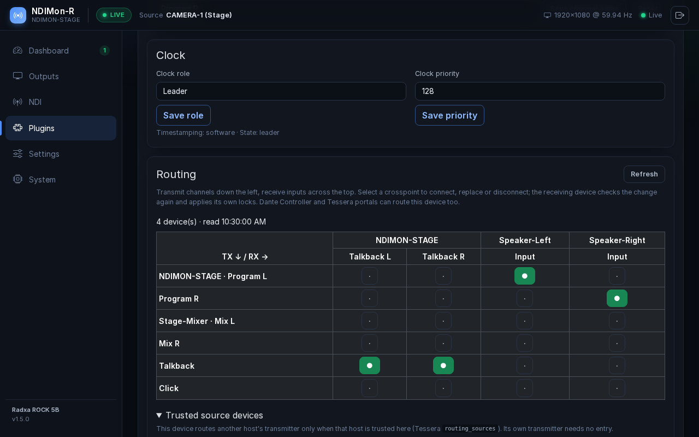
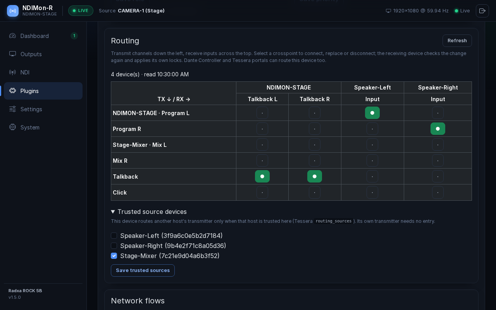
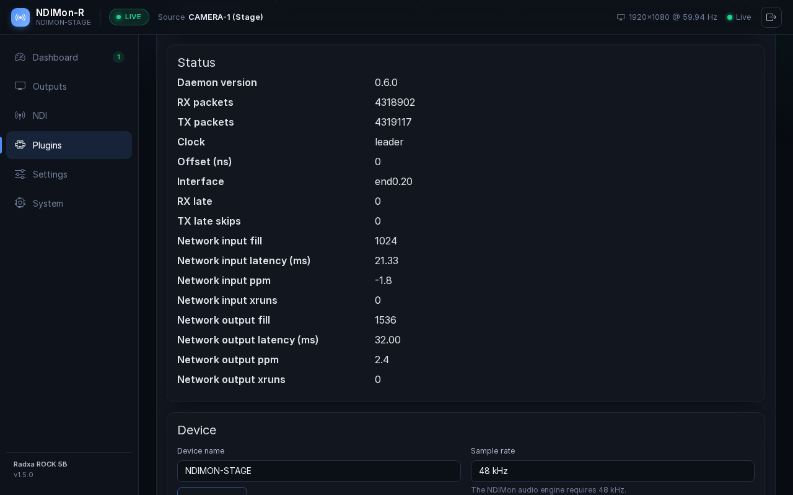

# Tessera network audio

Tessera adds network audio (static unicast flows, a software PTP media clock and
ALSA devices) to NDIMon-R. Install and enable the **Tessera** plugin in
**Plugins**, then open its tab. Installing and enabling the plugin makes the
settings page available; by itself it does not select the experimental audio
engine v2. The route editor is **Outputs → an output → Advanced → Audio**; the
device, clock, flow and channel-name settings stay in this plugin. Saving an
output's routes selects engine v2 in the same command: when v1 is running, the
device reports the impact (a decoder restart that can pause video briefly) and the
page asks before saving. **Enable network audio** on the plugin tab does the same
for the legacy primary routes; **Disable network audio** and **Return to audio
engine v1…** go back to v1 and keep the saved choices.

The Tessera daemon and runtime are developed in the
[Tessera repository](https://github.com/markfen88/Tessera); the plugin archive that
carries a pinned runtime bundle is published in
[NDIMon-Plugins](https://github.com/markfen88/NDIMon-Plugins). Network audio is
experimental.

## Requirements and compatibility

- **NDIMon-R 1.5.0 and Tessera 0.6.0 (minimum runtime 0.3.0).** The runtime
  release a plugin archive embeds is recorded in `bundles.lock.json` and
  `compatibility.json`, which `cargo xtask build-plugin` checks against the
  bundle; use an archive built from a Tessera 0.3.0 (or later) runtime bundle.
  This NDIMon-R release pins the public signed Tessera **0.6.0** release (tag
  `v0.6.0`, package version `0.6.0-1`, source commit
  `62b735d00d42d9a40565b59cdb7dbf4893862d1e`, short `62b735d`) and builds plugin
  archive **0.6.0-1** (`tessera-plugin_0.6.0-1_{amd64,arm64}.tar.gz`; the
  experimental Ubuntu 24.04 arm64 archive uses the same file name and is
  published separately). Control wire version stays 1: Tessera 0.6.0's control
  additions (new commands, queries, events, errors and status fields) are
  additive and NDIMon-R's client ignores unknown fields without changes.
- **Plugin `0.6.0-1` requires NDIMon-R 1.5.0 (`min_ndimon` 1.5.0).** Earlier
  NDIMon-R releases lock Tessera's flows (which stops the controller runtime
  from starting) and lack the routing API the plugin's **Routing** card uses.
  Update NDIMon-R to 1.5.0 before installing plugin `0.6.0-1`.
- The device installs a runtime bundle only on Debian 13 (amd64 or arm64) and on
  Ubuntu 24.04 arm64, which is experimental
  (`tessera-bundle_0.6.0-1_arm64_ubuntu-noble-experimental.tar.gz`). The bundle
  is not interchangeable across OS and architecture combinations.
- A runtime bundle must ship Tessera's own `tessera-bundle` installer. The plugin
  builder refuses a bundle without exactly one executable `tessera-bundle`, so the
  0.2.x bundles cannot be packaged for 1.4.0, and the device refuses to install one.
- Flows are not locked. Rendering `[control] locked = ["flows"]` made Tessera's
  Controller compatibility runtime (`tessera-controller@main`) exit at every
  start ("flows is locked by the configuration") and answer no controller.
  Controller routing (Dante Controller, Tessera portals, the plugin's **Routing**
  card) installs its flows as controller flows; NDIMon-R's static flows stay host
  configuration, and controller flows are observed and not reported as drift. The
  retired probe-flow file stays empty.
- Receiver routing (the **Routing** card, discovery browsing and trusted routing
  sources) needs Tessera 0.5 or later; NDIMon-R writes `[discovery]
  browse_devices = true` and `routing_sources` only for a 0.5 or later daemon
  (Tessera 0.6 also defaults `browse_devices` to true), so an older runtime
  keeps working without them.
- With Tessera 0.5 or later, NDIMon-R runs `tesserad` with Tessera's *native
  device role* (drop-in `tesserad.service.d/71-ndimon-native-device.conf`) and
  adds a condition drop-in keeping `tessera-controller@main` from starting,
  because the compatibility runtime cannot route this device's own inputs.
  NDIMon-R switches it on once when it first sees a 0.5 or later daemon (one
  `tesserad` restart, pausing network audio briefly) and only when the setting
  actually changes. Subscriptions are kept by the daemon across restarts.
- The host enforces `min_ndimon`, not a tested-build matrix. Compatibility metadata
  does not certify external hardware or every host build.

The base installation does not fetch or compile Tessera. Install the matching plugin
archive through Plugins; updating NDIMon-R alone does not replace an installed
plugin or its embedded runtime, and a new runtime reaches a device only as a rebuilt
plugin archive.

To assemble an archive from a checkout, download the matching runtime bundle and keep
its original filename, then run:

```sh
cargo xtask build-plugin tessera --bundle /path/to/tessera-bundle_VERSION_amd64.tar.gz
# Or the experimental Ubuntu 24.04 ARM bundle:
cargo xtask build-plugin tessera --ubuntu-experimental-bundle /path/to/tessera-bundle_VERSION_arm64_ubuntu-noble-experimental.tar.gz
```

The builder checks the bundle's checksum, source commit, platform and integration
contract against `bundles.lock.json` and `compatibility.json`, and writes the plugin
archive (`tessera-plugin_VERSION_ARCH.tar.gz`), a catalog entry and `SHA256SUMS`
under `dist/plugins/`. Use a clean directory for a release: `SHA256SUMS` lists every
plugin archive present. The plugin version does not change the NDIMon-R version.

## Installing and enabling

Upload the plugin archive or pick it from a feed in **Plugins** (see
[plugin feeds](../plugins.md#feeds)). Before anything on the device changes, privd
verifies the runtime bundle: exactly one `tessera-bundle_*.tar.gz` whose SHA-256
matches the lock, a runtime manifest that agrees with the lock, one executable
`tessera-bundle` in the bundle, and a supported platform. This is already checked
when the archive is inspected, before the install is accepted: a refused bundle
leaves no plugin files, no `broken` entry, no registry entry and no rendered
Tessera configuration (`/etc/tessera/config.d`, `/etc/alsa/conf.d`), and the reason
is returned to the page with status 400. A bundle
that passes is installed with the bundle's own `tessera-bundle install` using the
NDIMon-R profile. The lock pin, copied from the release's signed `SHA256SUMS`, is
the authentication (the installer runs with `--allow-unsigned`). When the bundle
may replace the program of a running `tesserad` (Tessera's install record names
another runtime version or an earlier install left a restart pending, or there
is no record: a 0.1.0 or 0.2.x runtime predates the installer), the install
restarts the daemon, which interrupts network audio for a moment; the plugin
update already asks before its services restart. Installing the same version
again restarts nothing, and a first install starts the daemon.

Enabling the plugin synchronizes the network binding and starts `tesserad.service`;
disabling it stops the daemon. Removing the plugin runs `tessera-bundle uninstall`
(with `--purge` for a purge), deletes the rendered Tessera files listed below and
reloads systemd.

The plugin archive and the packaged copy under `/usr/share/ndimon/plugins/tessera`
carry only `plugin.json` and `ui.html` (the archive adds the bundle and its lock):
no JavaScript, shell or Python. The packaged copy is used only for a Tessera the
device has accepted and that has no bundle under `/opt/ndimon-r/plugins`; a device
that never had Tessera lists no plugin.

## Who owns what

Tessera's device, channel labels, clock, static flows and ownership locks live in
the NDIMon-R desired state, and every change is a typed command. The plugin
fragment (`ui.html`) is unchanged; the settings routes below are served natively by
`ndimon-control`, and the former JavaScript plugin is gone. The control plane talks
to `tesserad` over `/run/tessera/control.sock` with its own implementation of the
version-1 control protocol (no Tessera crates are linked); `ndimon-control` is a
member of the `tessera` and `tessera-admin` groups for that.

When a 1.3.x appliance is upgraded, the importer reads Tessera's effective name,
latency, encoding, channel counts, labels, clock settings and static flows from
the files below `/etc/tessera/config.d` and the runtime state into the desired
state, so nothing is guessed, and NDIMon-R then owns and locks those values.

| File | Content | Rendered by |
|---|---|---|
| `/etc/tessera/config.d/60-ndimon.toml` | Device `main` (name, rate, encoding, latency, channel counts and labels), clock role and priority, discovery advertisement and (Tessera 0.5+) browsing, trusted routing sources, and the `locked` lists that pin the device and clock values | `ndimon-privd`, from the desired state |
| `/etc/tessera/config.d/61-ndimon-flows.toml` | Static flows | same |
| `/etc/systemd/system/tesserad.service.d/71-ndimon-native-device.conf`, `/etc/systemd/system/tessera-controller@main.service.d/71-ndimon-native-device.conf` | With Tessera 0.5+: the native device role in `tesserad` (vendor token `Audinate`, as the compatibility runtime's) and a condition that keeps `tessera-controller@main` from starting; with an older runtime only a comment. A change runs `daemon-reload` and restarts a running `tesserad`. NDIMon-R's drop-ins do not change device rules | same |
| `/etc/tessera/config.d/90-probe-flows.toml` | Always empty: the retired second flow writer | same |
| `/etc/tessera/config.d/62-ndimon-network.toml`, `/etc/systemd/system/tesserad.service.d/70-ndimon-network.conf` | The locked interface of the audio network, and the dependency of `tesserad` on the network boot unit | the network engine |
| `/etc/alsa/conf.d/60-ndimon-tessera.conf`, `61-ndimon-tessera-ranges.conf` | PCMs `ndimon_net_in` and `ndimon_net_out` and the endpoint ranges the audio graph uses | `ndimon-privd`, from the audio graph |

Do not edit these files; they are overwritten. Before publishing any of them, privd
validates the complete staged configuration with `tesseractl config check`. Device
and clock values are pinned in the configuration's `locked` lists, so a change made
with `tesseractl` or a controller is refused by the daemon and appears as drift;
changes to unlocked runtime values are observed and reported. Because Tessera
refuses direct runtime setters for locked values, NDIMon-R applies its settings
through a typed `ReloadConfig` after rendering. A reload that restarts something
returns the daemon's complete impact and an opaque token; the `expect` field of a
page request is passed through as that token. A refusal or an uncertain failure
restores the previous document and artifacts and reloads the previous configuration.
Service stop and restart use NDIMon-R's own impact, while service reload uses
Tessera's token.

**Reload rule.** NDIMon-R reloads the daemon only when it would pick something up:
when a file below `/etc/tessera/config.d` differs from what the last reload saw, or
when the daemon is another process than the one it reloaded, and once after the
control plane starts. The status carries no process identity, so the process is
told by `metrics.daemon.uptime_ms` placed on the control plane's monotonic clock;
two readings of one process agree, a restarted daemon starts later. A daemon that
reports no uptime is told apart by its files only. The reload a transaction sends is
not repeated by the replay after it, and a daemon that cannot be reached is skipped
and reloaded once when it returns.

A backup includes Tessera as the `tessera` entry of its `plugins` section, written
from the native domain while the plugin is enabled: the static flows and the
`net-in`/`net-out` audio endpoints. The device settings, labels and clock stay with
the device. A restore refuses channel counts that differ from the configured device
instead of creating mismatched PCM and audio geometry.

## Network ownership

NDIMon-R owns OS networking when it hosts Tessera. Define the networks in
**Settings → Network**, pick the NDI role on the NDI page and Tessera's audio network
in this plugin; all of them apply through the same protected
[network transaction](../network-vlans.md) with its 60-second **Keep changes**
window. The daemon is pinned to the selected interface with a locked primary
network. A saved Tessera assignment is retained while the plugin is removed and
restored when it is installed again. Standalone Tessera's own network editor
refuses to change a device that NDIMon-R owns.

**Network changes need a certified backend.** NDIMon-R changes a device's network
only for backends listed in the root-owned
`/etc/ndimon-network-certified-backends.json` (a JSON array of backend names). The
`ndimon-privd` package installs it listing all four backends (`networkd`,
`netplan`, `networkmanager`, `ifupdown`), and an upgrade keeps your edits. If you
withdraw the device's backend, or the file is missing or unusable, the Network page
shows the live configuration read-only and every change, including the assignment
of the Tessera network and the handoff below, is refused with
`backend_not_certified`. See [network profiles](../network-vlans.md#backend-validation).

### Handoff from a standalone Tessera install

Moving a device that already runs standalone Tessera to NDIMon-R (or back) needs an
explicit handoff; two managers never edit the same port. The standalone Tessera side
offers its configuration with its own handoff step (see the Tessera documentation).
On NDIMon-R, the authenticated routes are:

| Route | Body | Purpose |
|---|---|---|
| `POST /v1/Network/handoff/prepare` | `{}` | Make NDIMon-R the releasing side: it quiesces its own network management and returns an offer |
| `POST /v1/Network/handoff/cancel` | `{"id": "..."}` | Cancel an offer |
| `POST /v1/Network/handoff/import` | `{"source": {"product": "tessera", "id": "..."}}` | Review a peer's offer. The reply's `result.impact.token` seals what you reviewed |
| `POST /v1/Network/handoff/commit` | `{"source": {...}, "expect_impact": "<token>"}` | Take ownership. It stages the received configuration as an ordinary pending network change |

Import and commit are refused while NDIMon-R has already committed a network
configuration of its own (`locked`). Commit does not keep the change: use the
regular pending, **Keep changes** and revert controls within 60 seconds. If the
backend is not listed as validated, import and commit fail with `backend_not_certified`.

## Setup and routing

1. Define the required networks under **Settings → Network**. Select the NDI role on
   the NDI page and Tessera's audio role in this plugin.
2. Configure the Tessera device at 48 kHz, channel counts, RX/TX channel names, clock
   and matching static flows. Labels support individual save and reset.
3. Open an output's blue **Advanced** control (collapsed by default). Add NDI or
   Tessera inputs and HDMI or Tessera destinations. Select both HDMI and Tessera to
   send that output mix to both. Full-device and named mono ranges are offered; two
   mono selections mix rather than forming a stereo pair.
4. Set input gain and input delay and a separate destination delay, then **Save
   output audio**. Every selected input feeds every selected destination. Delays are
   whole milliseconds, 0–5000 each, at most 5000 ms combined for an active
   input and destination pair; gains are −60 to +12 dB (−60 mutes). A disabled output
   retains its selections.
5. Saving selects experimental engine v2 together with the routes. If v1 was
   running, confirm the decoder restart when the page asks. To recover the original
   path, use **Return to audio engine v1…** in the output audio editor; the saved
   selections are kept but inactive. Readiness, endpoint errors and runtime timing
   are in the [audio API](../api/output-audio.md).

Device settings, as validated by the control plane:

| Setting | Limit |
|---|---|
| Name, channel labels | The name is 1–31 UTF-8 bytes and a label at most 31 bytes; no control characters |
| Sample rate | 8000–384000 Hz. Active NDIMon-R audio endpoints require 48000 Hz |
| Encoding | 16, 24 or 32 bits |
| Latency | 1–1,000,000 microseconds. Input synchronization delay is set separately, in milliseconds |
| Channels | 1–16 per direction. The 48 kHz stereo PCM path is the initial validation target; other channel counts need validation |
| Clock | Role `leader`, `auto` or `follower`; priority 0–255, lower wins. Since 1.5.0 a fresh plugin install starts as `leader`, priority 128 (instead of `auto`). An existing Tessera installation keeps the role its running daemon reports (both in the one-shot 1.3.x import and when the control plane first adopts it), and a saved role is never changed; only a 1.3.x import whose daemon does not answer at boot starts as `leader`. Keep exactly one leader per network: two forced leaders split the clock and receivers drop the audio of the leader they do not follow. A priority below 64 makes the device a Preferred Leader, which a `follower` cannot be: that pair is refused (Tessera 0.5 refuses it too). Each is saved only when its Save button is pressed |

Disruptive device changes show the daemon's impact and require confirmation.



### Routing

With Tessera 0.5 or later, plugin archive **0.6.0-1** includes a **Routing**
card on the plugin tab (and shows the network output latency on the Status
card):
transmit channels of every discovered Tessera or Dante-compatible device down the
left, the receive inputs of every discovered receiver across the top (this
device first). Select a crosspoint to connect a source to an input, replace what the input receives, or
disconnect it; the page asks first, reads the input again (a receiver's review
token lasts 30 seconds) and sends one `route_receiver` command through the
daemon. The receiving device checks the change again and applies its own locks; a
refusal is shown with its reason, and a locked receiver is read-only. The matrix
refreshes every 15 seconds and after each change. A change that the daemon could
not finish in time (for example a receiver that stopped answering) leaves this
device's routing paused until its current state is reviewed: the card then offers
**Review and accept current routing**, which shows what the device reports now
and accepts it without retrying the change. Routing requests wait up to 15
seconds (previously 3 seconds; an abandoned request made Tessera block routing
until reviewed). Routing refusals are named with Tessera's message: `timeout`
(HTTP 504) when a receiver does not answer, and `refused` (HTTP 409) for an
expired routing inventory, an unavailable receiver read or a PIN-locked device.
Dante Controller and other Tessera portals can route this device as well.

To route another host's transmitter, that host must be trusted on the device that
sends the change: open **Trusted source devices** and tick it (saved as Tessera
`[control] routing_sources`, the 16-digit device ID). This device's own transmitter
needs no entry; another Tessera host that routes from this device needs this
device's ID in its own list. Sources must run the same sample rate and encoding.



The Status card shows the daemon version, packet counters, the clock state and,
per direction, the fill, latency, drift (ppm) and xruns of the network audio
input and output. Here the network output holds its 1536-frame target (32 ms).



### Static flows

Static flows are for peers that do not route.
A flow has an ID (1–32 letters, digits, `_` or `-`), a direction, a unicast peer IPv4
address (not 0.x, 127.x or 224.x and above) and a UDP port 1024–65535. Every flow
carries every device channel in its direction, so both ends must agree on the channel
count. Only one RX flow is allowed; multiple TX flows may send to different peers.
An RX flow may instead accept any source (`any_source`, RX only, no peer);
`frames_per_packet` (1–1024) is TX only. Two flows with the same direction, peer and
port are refused, and the whole set is limited to 60 KB. Save flows validates the set
before applying it, and removing a row takes effect only after Save flows.

The plugin's legacy **Network input delay** (0–2000 ms) and four-gain controls
project only the primary output. Prefer Outputs for independent
multi-input and multi-destination routes. A primary graph that cannot be represented
safely returns `legacy_edit_unsupported`, and a legacy matrix change can require
`normalize_matrix: true` after review; both refusals leave the saved graph unchanged.
There is no automatic HDMI/Dante delay measurement.

Start, stop and restart control only the Tessera daemon, and stop and restart ask
before interrupting network audio. If the daemon is offline the status strip says so
and the rest of the page stays available for diagnostics and recovery. **Download
diagnostics** exports the daemon's status and metrics as JSON, and the Advanced
section shows the generated flow configuration and daemon warnings.

### Tessera 0.6 features

Tessera 0.6.0 adds a host router (its default grid reproduces 0.5 exactly:
RX *n* → host output *n*, apps → TX, monitoring and configured flows), mixers,
per-channel and per-port gain and mute, an output level and mute stage after the
mix, local monitoring and card inputs reaching host outputs without a network
flow, hardware control surfaces (MIDI over ALSA rawmidi, HID or TCP MIDI; an
Allen & Heath CQ profile ships) that can drive those levels, and Router, Mixer
and Surfaces pages in Tessera's portal. See
[Tessera's changelog](https://github.com/markfen88/Tessera/blob/main/CHANGELOG.md)
for details.

Behaviour notes relevant to NDIMon-R operators:

- `browse_devices` now defaults to true in Tessera (NDIMon-R already renders it
  on for 0.5 and later).
- The monitor delay defaults to auto.
- `tesserad.service` gains `SupplementaryGroups=audio` and ALSA/hidraw device
  access; NDIMon-R's drop-ins do not change device rules.

Tessera's portal and `tesseractl` manage these features; NDIMon-R 1.5.0 does not
yet expose them in its own UI.

## Page routes

The fragment is initialized by `NDIMON_PLUGIN_INIT_tessera(pane)` and returns a
cleanup callback. It uses the host's `get`, `post` and `toast` helpers, which handle
authentication; all selectors and listeners belong to the pane. Polling issues one
status request, waits for completion, then waits two seconds, and unmounting stops
the timer. Status reads never opt into audio v2 or change anything.

All routes are relative to `/v1/plugins/tessera`. Every route except the lifecycle
verbs answers 404 `not_found` ("Tessera plugin is not enabled") while the plugin is
not installed and enabled.

| Route | Request and reply |
|---|---|
| `GET /health` | `{installed, daemon}` |
| `GET /status` | `{daemon, status, metrics, engine, flows, audio, audio_engine, audio_enabled, bundle, capabilities, flow_toml, error}`. `daemon` is `online` or `offline`; `status.devices[]` uses the device key `main`. Cached for two seconds and invalidated by a new desired-state revision |
| `GET /metrics`, `GET /diagnostics`, `GET /flows` | Daemon metrics; `{status, metrics, flows, experimental}`; `{flows, toml}` |
| `GET /subscriptions` | 501 `unsupported`: use the routing routes |
| `GET /routing/devices?cursor=` | Tessera 0.5+ routing inventory page (`routing_devices`: `devices[]`, `next_cursor`); 501 `unsupported` before 0.5 |
| `GET /routing/channels?id=&generation=&direction=rx\|tx&cursor=` | Channels of one device (`routing_channels`) |
| `GET /routing/receiver?id=&generation=&first=` | One receiver page with each input's current source and review `expectation` (`routing_receiver`) |
| `POST /routing/route` | `{expectation, change}` with `change` one of `{connect:{source:{endpoint,channel}}}`, `{replace:{previous:{tx_device,tx_channel},source}}`, `{disconnect:{previous}}`; answers `{ok, result}` with the daemon's operation (`state`: `receiver_confirmed`, `pending`, `{refused:{reason}}` …) |
| `GET /routing/inspect` | The complete review of this device's inputs after an uncertain change (`receiver_recovery`: `observed`, `expected`, single-use `review`) |
| `POST /routing/reconcile` | `{review}`: accept what the device reports now; the unfinished change is not retried |
| `POST /routing/sources` | `{sources: ["<16 hex digits>", ...]}`: the trusted source hosts (at most 64) |
| `POST /device` | One of `{name}`, `{sample_rate}`, `{encoding}`, `{latency_us}`, `{label: {direction: "rx"\|"tx", channel, label}}` (a null label resets it) |
| `POST /channels` | `{rx, tx}` (1–16 each) |
| `POST /clock` | One of `{role: "auto"\|"follower"\|"leader"}`, `{priority}` |
| `POST /flows` | `{flows: [{id, direction, peer?, port, any_source?, frames_per_packet?}]}` |
| `POST /service` | `{action: "start"\|"stop"\|"restart"\|"reload"}` plus `confirm` or `expect` |
| `POST /audio/enable` | `{confirm: true}` after explicit confirmation. Requires the daemon's main device at 48 kHz |
| `POST /audio/disable` | `{}` |
| `POST /audio/delay` | `{ms}` (0–2000; legacy primary projection) |
| `POST /audio/routing` | `{hdmi: {ndi, "net-in"}, net_out: {ndi, "net-in"}}` in dB (−60 to 12; legacy primary projection) |
| `POST /enable`, `/disable`, `/update`, `/uninstall` | The plugin lifecycle verbs of [Plugins](../plugins.md#lifecycle) |

A change that restarts the daemon or video is answered with `{ok: false, error:
"confirmation_required", impact: {token, ...}}`. After showing the impact the page
retries the exact same request with `expect: impact.token`; cancelling sends
nothing. Other refusals are `{ok: false, error, detail?}`; the host `post` helper
keeps the structured body, including on HTTP 409. Dynamic strings are assigned
through DOM properties and text nodes, never HTML interpolation.

## Upgrading

- **From the NDIMon-R 1.3.x plugin.** An installed Tessera plugin and its runtime
  stay in place and are recognised as the native Tessera plugin; its old JavaScript
  files are no longer used. The upgrade imports the effective Tessera latency, name, channel layout,
  labels and flows into the desired state, and a runtime without flow-lock support
  reports a flow ownership conflict until you install a plugin archive built from
  Tessera 0.3.0 or later.
- **To NDIMon-R 1.5.0 and plugin archive 0.6.0-1 (from Tessera 0.5.2).** Update
  NDIMon-R to 1.5.0 first, then install plugin archive **0.6.0-1** (Tessera
  0.6.0 runtime) from **Plugins**: core updates do not replace an installed
  plugin archive, and `0.6.0-1` requires NDIMon-R 1.5.0 (`min_ndimon` 1.5.0)
  because earlier NDIMon-R releases lock flows (stopping the controller runtime
  from starting) and lack the routing API the **Routing** card uses. Installing
  `0.6.0-1` over 0.5.2 passes `--restart` because the runtime version changes,
  restarting `tesserad` once and briefly pausing network audio. When NDIMon-R
  1.5.0 first sees a Tessera 0.5 or later daemon, switching `tesserad` to the
  native device role also restarts the daemon once if not already set. Existing
  saved clock roles are kept and an existing installation keeps the role its
  running daemon reports; a fresh plugin install now starts as PTP `leader`
  (priority 128), so change it to `follower` or `auto` if another leader already
  runs on the network.
- **Updating the runtime.** Install the newer plugin archive from Plugins. The
  update asks before its services restart, then restarts `tesserad` on the new
  runtime; expect network audio to stop for a moment.
- **Mixed networks (0.3 vs 0.5/0.6).** The PTPv1 media clock is unchanged
  between Tessera 0.5 and 0.6, so 0.5 and 0.6 devices can share a network. A
  network that mixes 0.3.x with 0.5 or 0.6 devices is still not supported:
  Tessera 0.5 changed the media clock so a leader-capable device advertises
  stratum 0x2A to 0x2D (by priority) instead of 4, keeping hardware leaders in
  precedence (a 0.3.0 device's stratum 4 therefore wins every election against
  it). Sync messages come every 250 ms instead of every second, and general
  messages use DSCP 46 (EF) instead of 8 (event messages keep 56): update switch
  QoS rules that match the old marking. A follower advertises stratum 255, and a
  priority below 64 makes a Preferred Leader. The new clock takes effect when
  `tesserad` restarts, which the plugin update does. When moving from 0.3.x,
  upgrade NDIMon-R devices (this plugin), standalone Tessera hosts and speakers
  in one maintenance window.
- **Going back to an earlier runtime.** Tessera's installer refuses a downgrade.
  A Tessera 0.5.x daemon also refuses the configuration keys 0.6 introduces
  (`[host_volume]`, `[router]`, `[[mixer]]`, `[[surface]]` and new `[[bridge]]`
  keys). Remove the 0.6.0 plugin without purging (or run the 0.6.0 bundle's
  `uninstall --yes`, which keeps `state.toml.<version>`), then install the
  plugin archive of the earlier runtime; saved gain, mute, router, mixer and
  surface settings are not carried back. On a network that went back to 0.3.x,
  every device must go back (0.5 and 0.6 devices can still share a network).
- **Purge.** Removing with purge runs `tessera-bundle uninstall --purge`, which
  removes what the bundle created. `/var/lib/tessera-rate` (the speaker sample-rate
  follower's state, created by `tessera-web` on speaker hosts) is left behind;
  delete it by hand if it exists.
- **Standalone Tessera.** Newer standalone Tessera releases have their own
  management and audio VLAN editor. It refuses changes when NDIMon-R ownership
  markers are present; moving a configured standalone device to NDIMon-R uses the
  handoff above.

## Limits

- Network audio is experimental on both supported platforms. Sustained clock
  stability and external hardware interoperability are not certified.
- Controller routing interoperability (Dante Controller) is a property of the
  runtime release you install; the plugin was tested with Tessera 0.5.2 peers.
- Tessera 0.6.0's host router, mixers, per-channel and per-port gain/mute,
  post-mix output level/mute, local monitoring, and hardware control surfaces
  are not yet exposed in NDIMon-R's UI; manage them through Tessera's portal or
  `tesseractl`.
- No automatic lip-sync or HDMI/Dante delay measurement. The offset between HDMI
  and network audio is set by hand (route delay), but it now stays put after
  every restart: the network audio output is aligned to its target in one step as
  soon as its stream runs (and again after an xrun or a jump of more than four
  periods), and the drift loop afterwards only follows clock drift (limit
  ±3000 ppm). Audio status reports `latency_frames`, `target_frames` and `aligns`
  per sink, and the plugin's Status card shows the network output latency. The
  receiving device's own chain (for example a speaker's DSP buffering) and the
  display's picture processing still add their own fixed delays.
- Software PTP was tested; hardware timestamping through VLAN interfaces has not been
  validated.
- Runtime behaviour such as the Tessera portal and its default login belongs to
  the runtime release (for example, 0.5.2 and 0.3.0 start the portal with the
  password `tessera` on a fresh install, keep an existing password on upgrade,
  and answer on loopback only until `listen` is changed in `web.toml`); read the
  notes of the release you install and change the portal password before
  connecting the device to a shared network.
